# Look evidence (NFR-09)

Screenshots from `pnpm e2e --flow apps/mobile/e2e/app-look.yaml` (fake transport, emulator `guardian`); mockups from `scripts/mockup-shots.sh`. Differences listed under *Out* in the plan are expected (e.g. fake data, no position line, no Old Mill card).

| Screen | Light | Dark | Mockup |
|---|---|---|---|
| Dashboard (empty) | 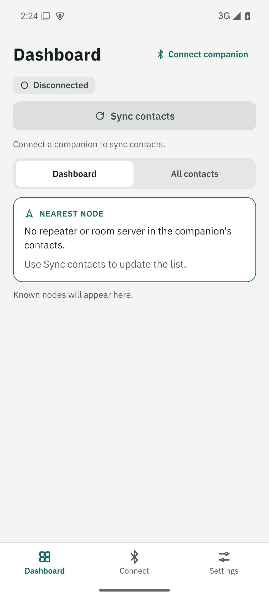 | 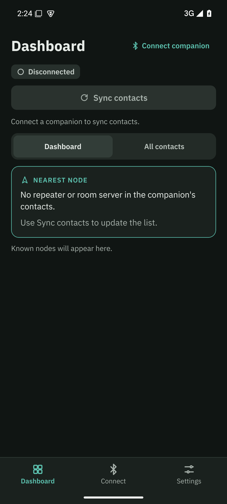 |  |
| Connect (idle) | 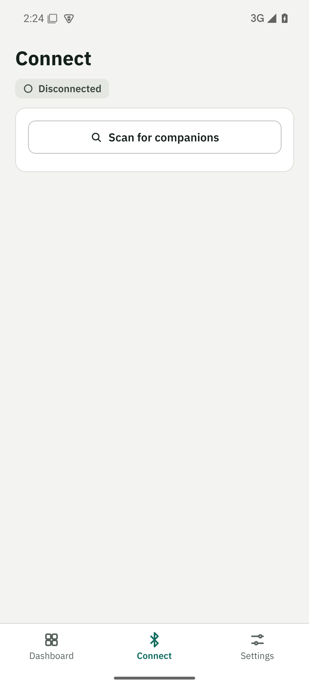 | 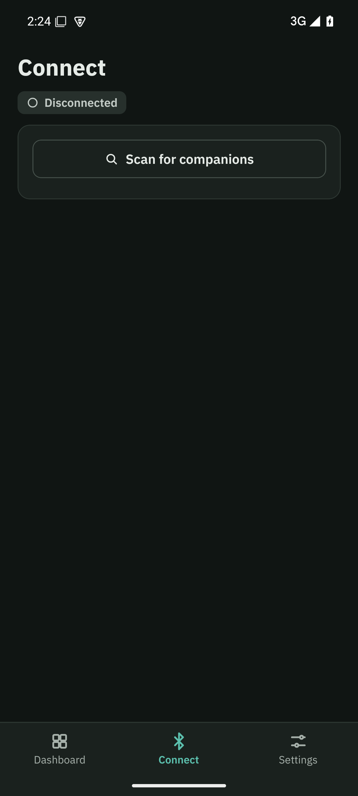 | 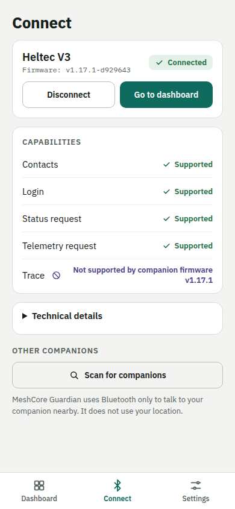 |
| Connect (connected) | 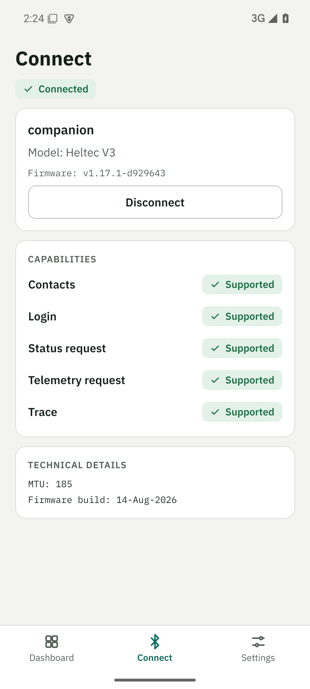 | 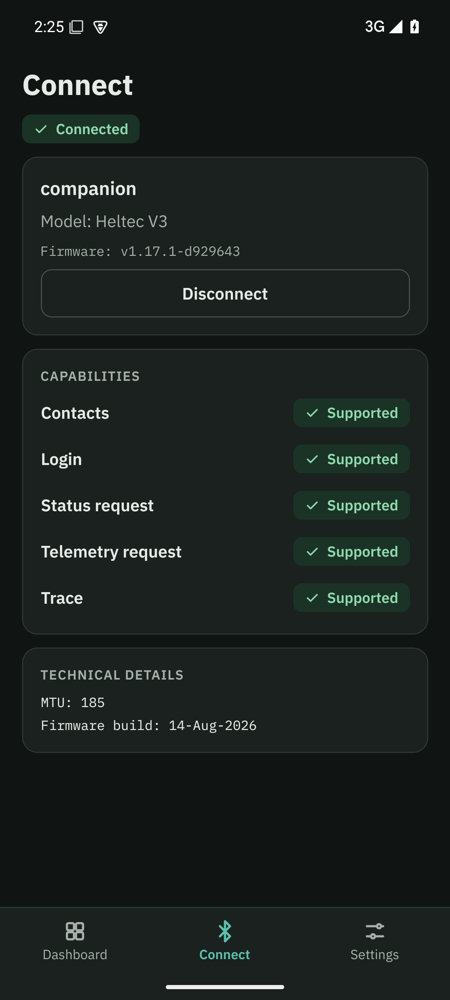 |  |
| Dashboard | 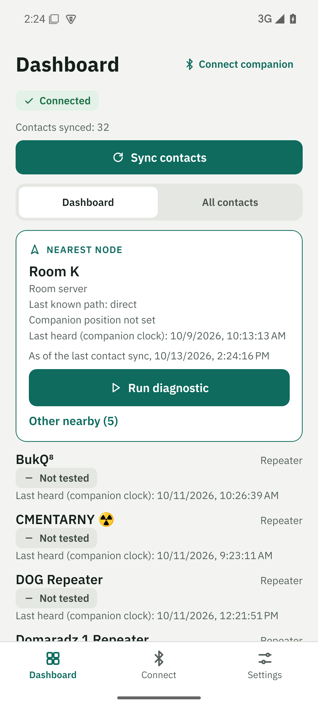 | 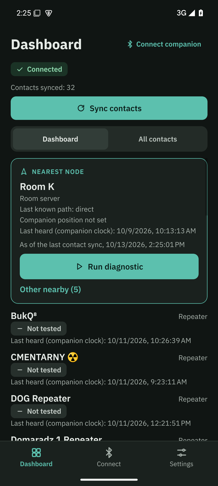 | 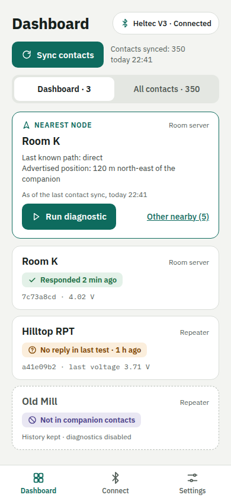 |
| Node | 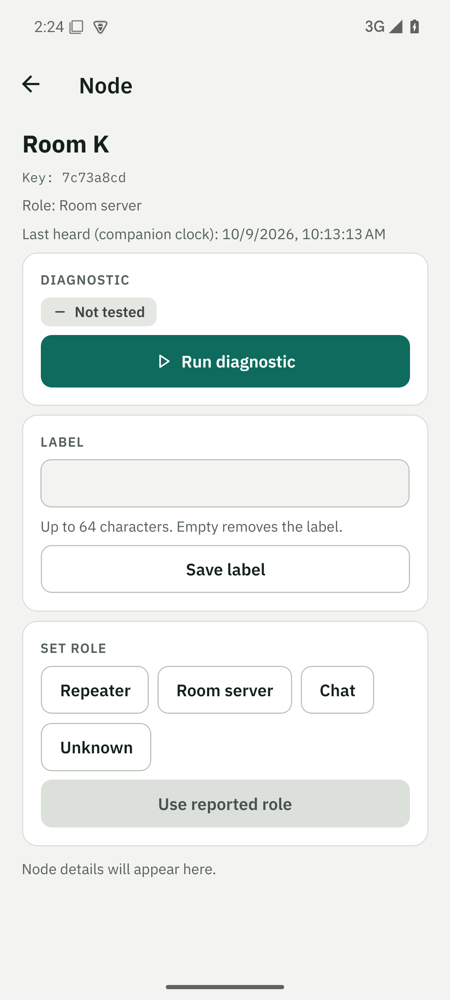 | 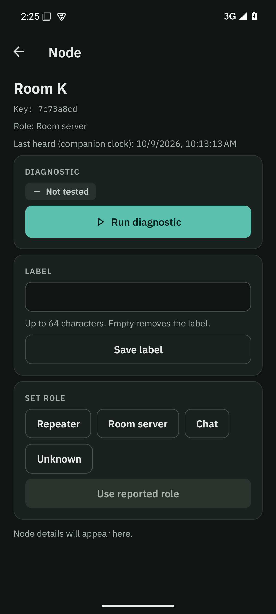 | 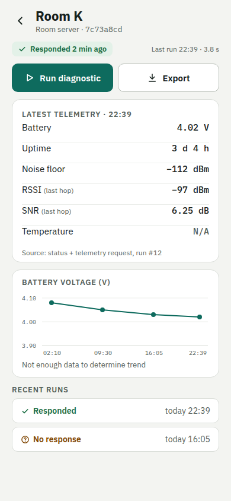 |
| Run in progress | 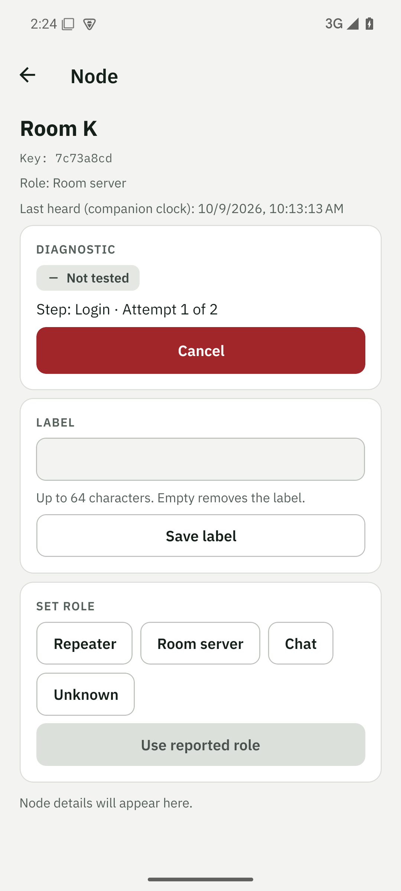 | 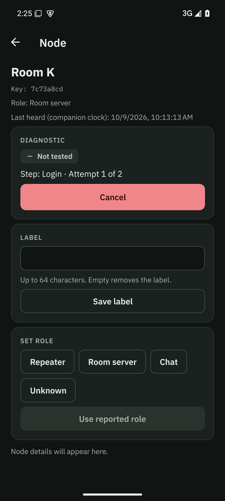 | 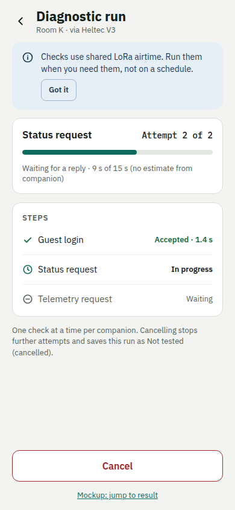 |
| Node after run | 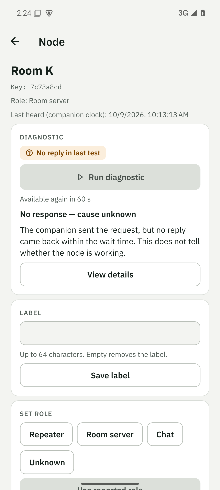 | 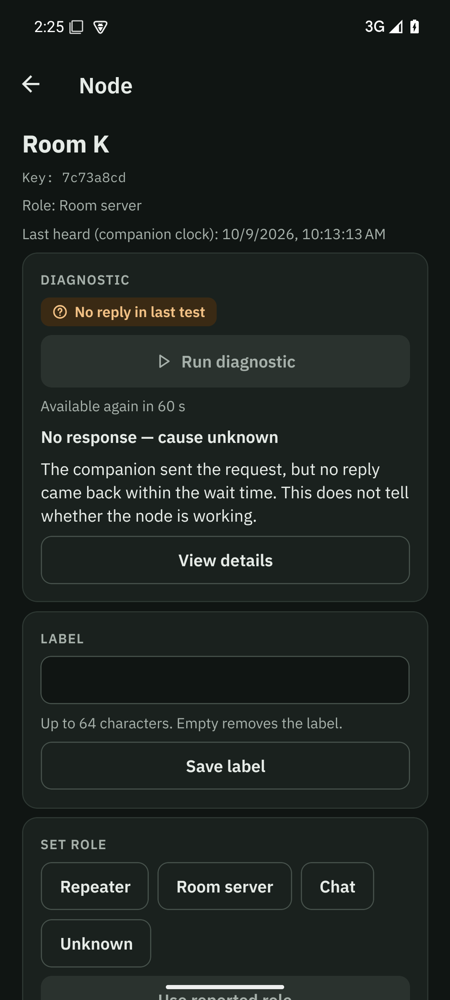 |  |
| Run result | 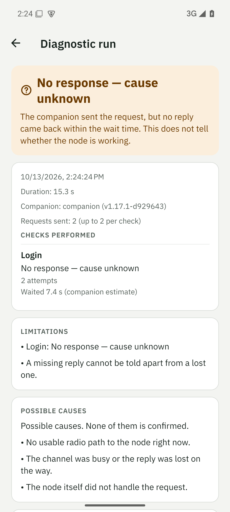 | 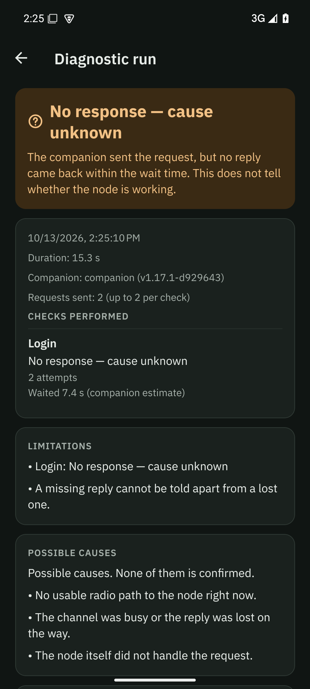 | 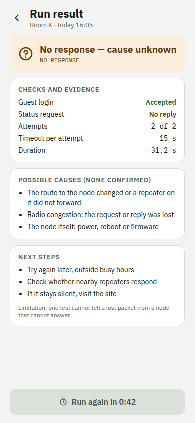 |
| Settings | 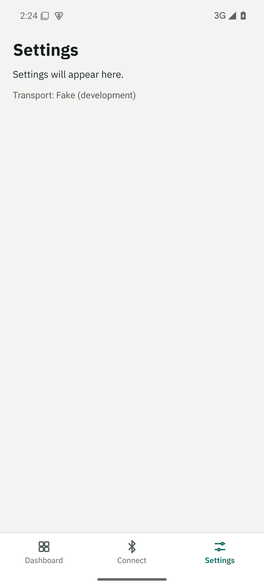 | 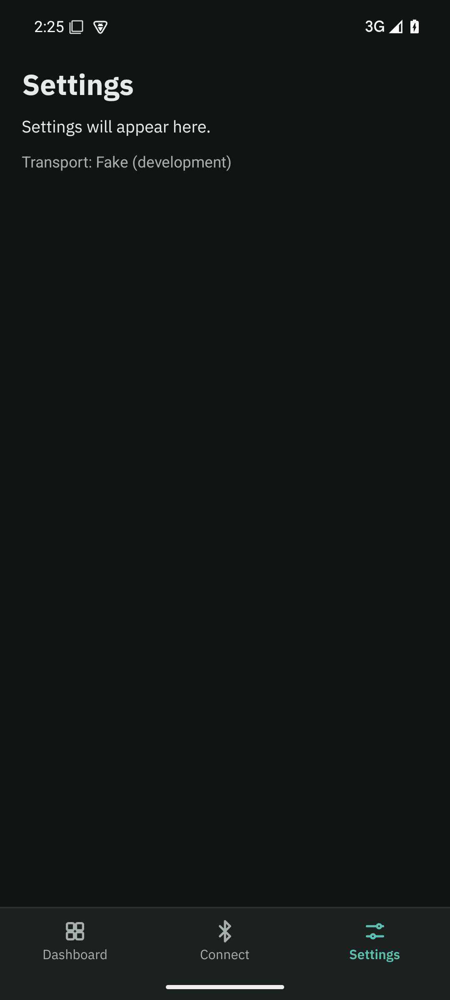 | 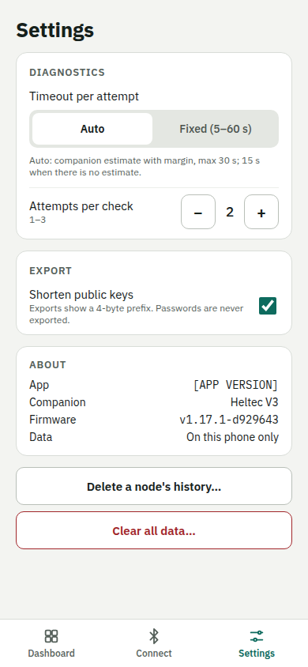 |
